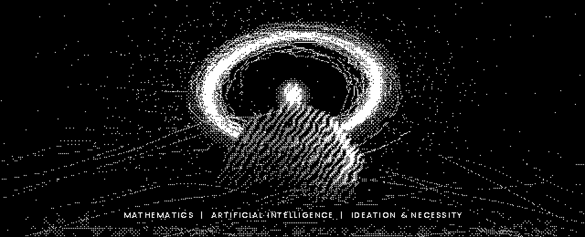

<h1 align="center">Nirmal Arsade</h1>

<b>Backend Developer &nbsp;·&nbsp; AI Engineer</b>

Building systems that see, hear and read.

  <a href="https://linkedin.com/in/nirmalarsade">LinkedIn</a> &nbsp;·&nbsp;
  <a href="mailto:nirmal.arsade123@gmail.com">Email</a>

 

<table>
<tr>
<td valign="top">

### About

B.Tech graduate in Computer Science & Design, based in India.

I work where **machine learning meets production backends**: FastAPI services, async pipelines, and models that process video, speech and text. I care about systems that actually run, not demos.

I'm drawn to the same thing in space films that I like in engineering: a hard problem, a tight system, and no room for sloppy work.

</td>
<td width="260" align="center"></td>
</tr>
</table>

### Recognition

🏆 **Best Research Paper Award, ICASTM** for **PrepVista**, a multimodal AI system that evaluates interviews across face, voice and language and returns structured feedback.

### Stack

| | |
|:--|:--|
| **Languages** | `C` `C++` `Python` `SQL` |
| **Backend** | `FastAPI` `Node.js` `REST APIs` `SQLAlchemy` `Async` |
| **Data** | `MySQL` `Firebase` `Supabase` |
| **AI / ML** | `Machine Learning` `Deep Learning` `Computer Vision` `NLP` `Multimodal AI` |
| **Libraries** | `NumPy` `Pandas` `Matplotlib` `Scikit-learn` `OpenCV` `MediaPipe` `DeepFace` `Whisper` `Librosa` |
| **Mobile & Maps** | `React Native` `Expo` `OpenStreetMap` `Leaflet` |
| **Tools** | `Git` `GitHub` `VS Code` `Postman` `npm` `uv` `Uvicorn` `Linux/Bash` |
| **Core CS** | `DSA` `OOP` `DBMS` `MVC` `Software Engineering` |

### What I work on

**Computer vision** (image and video processing, facial analysis) · **Speech and audio** (recognition, feature extraction) · **NLP** · **Multimodal AI** · **Backend systems** (REST APIs, async services, database design)

### Now

Building backend and AI projects, going deeper into how ML systems work internally, and open to backend and AI engineering roles.

 

Reach me on <a href="https://linkedin.com/in/nirmalarsade">LinkedIn</a> or at nirmal.arsade123@gmail.com

